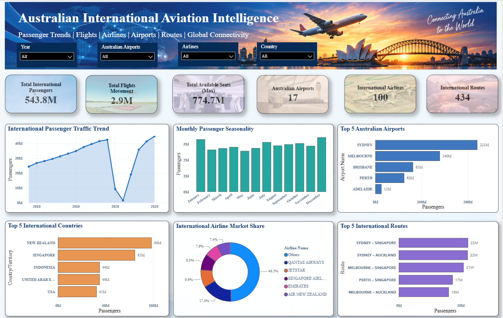

<div align="center">

# ✈️ Australian International Aviation Intelligence

### From Raw Aviation Data to Business Insights & Passenger Forecasting

**An End-to-End Data Analytics & Machine Learning Portfolio Project**


**Passenger Trends • Airport Performance • Airline Market Share • Route Analysis • Demand Forecasting**

</div>

---

## 🌏 The Story Behind This Project

Every year, millions of passengers travel between Australia and the rest of the world.

But behind every flight, airport and passenger movement, there is data that can help businesses make better decisions.

**What if we could use this data to understand:**

- ✈️ Which Australian airports handle the most international passengers?
- 🌍 Which countries and routes are most popular?
- 📈 How has international travel recovered since COVID-19?
- 📅 When is passenger demand highest?
- 🤖 Can machine learning predict future passenger traffic?

**That's exactly what this project explores.**

Using historical aviation data, I built an end-to-end analytics solution that transforms raw datasets into business insights, an interactive Power BI dashboard and 12-month passenger forecasts.

---

## 📊 Interactive Power BI Dashboard

A central part of this project is an interactive Power BI report that brings the aviation analysis together in one place.



*Power BI dashboard developed to explore Australia's international aviation performance.*

📁 **Want to explore the report?** Open the `05_PowerBI` folder and download the `.pbix` file using Power BI Desktop.

---

## ⭐ Project Highlights

| Area | Key Result |
|---|---|
| 📈 Passenger Traffic | 44.85 million international passengers in 2025 |
| 🛫 Leading Airport | Sydney — 199.48 million historical passengers |
| ✈️ Leading Airline | Qantas — 16.99% passenger market share |
| 🌏 Largest Country Market | New Zealand — 89.20 million historical passengers |
| 🏆 Best Forecasting Model | XGBoost — MAE of 241,890 passengers |
| 🔮 Forecast Period | July 2026 – June 2027 |

*Historical airport and market rankings use selected years excluding 2020–2022 and 2026.*

---

## 🎯 Business Problem & Objectives

International aviation is influenced by changing passenger demand, seasonal travel, economic conditions and unexpected disruptions.

Airports and airlines need reliable information to make decisions about flight schedules, staffing, route development and capacity.

### What I Wanted to Achieve

1. Understand how Australia's international passenger traffic has changed over time.
2. Identify the busiest airports, airlines and international routes.
3. Examine the impact of COVID-19 and the industry's recovery.
4. Explore seasonal passenger demand and flight capacity.
5. Build an interactive dashboard for easier decision-making.
6. Develop machine learning models to forecast future passenger traffic.

---

## 🛠️ Tools & Technologies

| Tool | How I Used It |
|---|---|
| 🐍 **Python & Pandas** | Cleaned datasets and prepared data for analysis |
| 🗄️ **PostgreSQL** | Analysed passenger traffic, airports, airlines and routes using SQL |
| 📊 **Power BI** | Built an interactive dashboard to present aviation insights |
| 🤖 **SARIMA & XGBoost** | Developed and compared passenger forecasting models |
| ☁️ **Google Colab** | Developed and tested Python notebooks |
| 📁 **Excel & CSV** | Worked with original, cleaned and forecast datasets |

---

## 🔄 My End-to-End Project Workflow

**01 — Data Collection**

Collected three historical datasets covering passenger movements, airline performance, international flights and seat capacity.

⬇️

**02 — Data Cleaning with Python**

Checked data types, missing values and duplicates. Prepared cleaned CSV files for further analysis.

⬇️

**03 — SQL Analysis with PostgreSQL**

Used SQL queries to investigate passenger growth, airport rankings, airline market share, popular routes and flight capacity.

⬇️

**04 — Power BI Dashboard**

Created an interactive report to present aviation trends and make the findings easier to explore.

⬇️

**05 — Machine Learning**

Compared SARIMA and XGBoost forecasting approaches using historical passenger data.

⬇️

**06 — Business Insights & Forecasting**

Selected the best-performing model, generated 12-month passenger forecasts and developed practical business recommendations.

---

## 🔍 Key Findings & Business Insights

### 1. 📈 International Aviation Has Recovered Strongly

International passenger traffic increased from **24.41 million in 2009 to 44.85 million in 2025**.

COVID-19 caused a major decline in 2020 and 2021. However, by 2025, passenger traffic had recovered to approximately **5.5% above 2019 levels**.

**💡 Business Insight:** Australia's international aviation industry has demonstrated a strong recovery, making passenger growth an important factor in future capacity planning.

**✅ Recommendation:** Airports and airlines should regularly review passenger demand and adjust their operational plans accordingly.

### 2. 🛫 Sydney and Melbourne Lead International Traffic

| Rank | Airport | Historical Passenger Traffic |
|---|---|---:|
| 🥇 1 | Sydney | 199.48 million |
| 🥈 2 | Melbourne | 125.20 million |
| 🥉 3 | Brisbane | 73.85 million |
| 4 | Perth | 56.74 million |

**💡 Business Insight:** Sydney and Melbourne are the leading international passenger hubs among Australian airports.

**✅ Recommendation:** Prioritise efficient resource planning at major airports while monitoring demand growth at other airports.

### 3. ✈️ Qantas Leads Airline Passenger Traffic

| Airline | Historical Passengers | Market Share |
|---|---:|---:|
| Qantas | 83.55M | 16.99% |
| Jetstar | 46.40M | 9.44% |
| Singapore Airlines | 43.03M | 8.75% |

**💡 Business Insight:** Qantas leads among individual airlines, while Jetstar and Singapore Airlines are also important participants in Australia's international aviation market.

**✅ Recommendation:** Airlines should monitor passenger trends and market share to identify competitive opportunities.

### 4. 🌍 New Zealand and Singapore Are Major Travel Markets

| Category | Finding |
|---|---|
| Largest country market | New Zealand — 89.20M passengers |
| Second-largest country market | Singapore — 72.07M passengers |
| Busiest international route | Sydney–Auckland — 20.30M passengers |
| Second-busiest route | Sydney–Singapore — 19.79M passengers |

**💡 Business Insight:** New Zealand and Singapore play important roles in Australia's international passenger network.

**✅ Recommendation:** Airlines should monitor demand on popular routes and assess opportunities to improve flight schedules and capacity.

### 5. 📅 Passenger Demand Changes Throughout the Year

Historical monthly averages during 2009–2019 show:

| Month | Average Passengers |
|---|---:|
| December | 3.24 million |
| January | 3.18 million |
| May | 2.44 million |

**💡 Business Insight:** December and January are generally the busiest months, while May experiences lower passenger demand.

**✅ Recommendation:** Prepare additional operational resources during peak months and consider suitable maintenance or training activities during quieter periods.

> **Important:** Airport, airline, country and route figures above are cumulative historical totals, excluding 2020–2022 and 2026. They are not annual passenger counts.

---

## 🤖 Machine Learning — Can We Predict Future Passenger Demand?

Understanding the past is useful, but predicting the future can help businesses plan ahead.

For this project, I developed and compared two forecasting techniques:

- **SARIMA:** A statistical forecasting method that identifies patterns in historical passenger data.
- **XGBoost:** A machine learning method that learns from historical passenger information to make predictions.

Both methods were tested using full-history and post-COVID training approaches.

### 🧪 Model Performance Comparison

**Testing period:** January 2025 – June 2026.

| Forecasting Model | MAE | RMSE |
|---|---:|---:|
| SARIMA — Full History | 562,681 | 634,857 |
| SARIMA — Post-COVID | 403,685 | 476,516 |
| **🏆 XGBoost — Full History** | **241,890** | **300,352** |
| XGBoost — Post-COVID | 258,176 | 328,226 |

### 🏆 Winning Model: XGBoost

**Why was XGBoost selected?**

It achieved the lowest MAE and RMSE among the four tested approaches.

In simple words, its predictions were closer to actual passenger numbers during the historical testing period.

**MAE explained:** An MAE of 241,890 means the model's predictions differed from actual monthly passenger totals by approximately 242,000 passengers on average during testing.

This does not guarantee the same accuracy for future predictions.

---

## 🔮 Forecasting International Passenger Demand

The selected XGBoost model was retrained using available historical data through June 2026 to forecast passenger demand for **July 2026 – June 2027**.

### Forecast Highlights

| Forecast | Month | Predicted Passengers |
|---|---|---:|
| 🔺 Highest Demand | January 2027 | 4.32 million |
| 🔺 Second-Highest | December 2026 | 4.30 million |
| 🔻 Lowest Demand | May 2027 | 3.35 million |

### What Does This Mean for Businesses?

- Airports can use the estimates to prepare for busy travel periods.
- Airlines can review expected demand when planning flight schedules.
- Operations teams can use forecasts as one input for staffing and resource planning.

**Note:** These are model-generated forecasts, not confirmed future passenger counts.

The complete monthly forecast is available in the `02_Cleaned_Data` folder.

---

## 💼 Business Recommendations

Based on the analysis, I identified five practical recommendations:

| Priority | Recommendation | Potential Business Benefit |
|---|---|---|
| 1 | Improve peak-season planning | Better preparation for high passenger demand |
| 2 | Monitor popular international routes | More informed flight scheduling |
| 3 | Match flight capacity with demand | Better use of available seats and resources |
| 4 | Use regularly updated passenger forecasts | More proactive operational planning |
| 5 | Strengthen data quality checks | More reliable reporting and forecasting |

These recommendations are based on analytical findings and would require additional operational and financial assessment before implementation.

---

## 📂 Project Files & Structure

```text
Australian-Aviation-Intelligence/
│
├── 01_Raw_Data/
│   └── Original aviation datasets (Excel)
│
├── 02_Cleaned_Data/
│   ├── Cleaned city-pair passenger data
│   ├── Cleaned airline passenger data
│   ├── Cleaned flights and seats data
│   └── Passenger forecast (2026–2027)
│
├── 03_Python/
│   ├── Data cleaning notebook
│   └── Machine learning forecasting notebook
│
├── 04_SQL/
│   └── SQL analysis queries
│
├── 05_PowerBI/
│   └── Power BI report (.pbix)
│
├── 06_Documentation/
│   ├── Problem statement
│   └── Project outcome report
│
├── aviation-dashboard-overview.png
│
└── README.md
```

### How to Explore the Project

| Folder | What You'll Find |
|---|---|
| `01_Raw_Data` | Original Excel datasets |
| `02_Cleaned_Data` | Prepared CSV files and passenger forecasts |
| `03_Python` | Python notebooks for cleaning and forecasting |
| `04_SQL` | SQL queries and analysis |
| `05_PowerBI` | Power BI report for interactive exploration |
| `06_Documentation` | Business problem, objectives, findings and recommendations |

**To explore the Power BI report:** Download the `.pbix` file and open it using Power BI Desktop.

**To review the forecasting process:** Open the machine learning notebook in Google Colab or Jupyter Notebook.

---

## 📚 About the Data

The project uses three aviation datasets:

| Dataset | Records | Coverage |
|---|---:|---|
| International City Pair | 32,808 | Jan 2009 – Jun 2026 |
| Airlines by Country | 22,466 | Jan 2009 – Jun 2026 |
| International Flights and Seats | 36,723 | Sep 2003 – Jun 2026 |

Together, these datasets provide information about passenger demand, airline activity, international routes, flight movements and reported seat capacity.

### Data & Model Limitations

- Some passenger records contain missing values.
- COVID-19 created unusual travel patterns.
- Forecasts may be affected by unexpected events or economic changes.
- Further independent model testing would strengthen confidence in future performance.

---

## 🎯 Skills Demonstrated

**Data Preparation:** Python, Pandas, Data Cleaning, Data Validation

**Data Analysis:** PostgreSQL, SQL, Exploratory Data Analysis, Trend Analysis

**Business Intelligence:** Power BI, Dashboard Development, KPI Reporting

**Machine Learning:** SARIMA, XGBoost, Time Series Forecasting, Model Evaluation

**Business Skills:** Problem Solving, Business Insights, Data Storytelling, Recommendations

---

## 🏁 Final Takeaway

This project demonstrates how data can support real-world business decisions in the aviation industry.

By combining **Python, SQL, Power BI and machine learning**, I transformed historical aviation datasets into useful insights about passenger demand, airline performance, airport activity and future travel patterns.

The key lesson from this project is simple:

**Data becomes valuable when it helps businesses understand what happened, why it matters and what they should consider doing next.**

---

<div align="center">

### ✈️ From Data to Decisions

**Python → PostgreSQL → Power BI → Machine Learning → Business Insights**

*An end-to-end Data Analytics & Business Intelligence portfolio project.*

</div>
